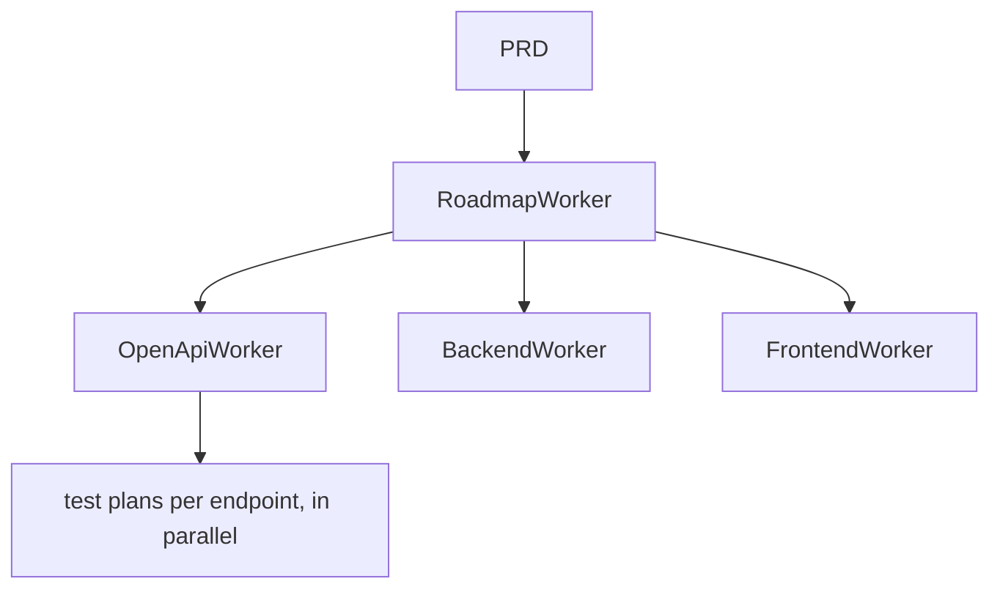

# Chapter 1. From PRD to Application

[← Previous](00-introduction.md) · [Contents](README.md) · [Next →](02-agent-loop.md)

Let's start not with the agent, but with its first real task. In March 2024 an internal plugin, then called **Matterhorn**, could do one thing: take a product description (PRD) and turn it into a working application. Not a sketch, not a list of files, but a project that builds, passes its tests, and runs.

This chapter is about how such a pipeline was built and which problems surfaced once it started working on real specifications. Almost everything described below can be traced in the repository history.

## 1.1. The task: a specification in, a project out

The input is the PRD text: what the application should do, which entities exist, which screens it has. The output is a file tree: backend, frontend, tests, configuration, a Dockerfile.

The immediate question is how to split one large task into steps that an LLM can carry out reliably. Matterhorn answered with a pipeline of workers. Each worker is a small stage with its own prompt, its own response format, and its own artifact. An artifact is an intermediate result that can be inspected in the IDE's tree, re-run, and replaced.

The pipeline looked roughly like this (class names are from the state of the repository in June 2024; the links are simplified):

```
PRD
 └─ RoadmapWorker        → list of tasks (roadmap)
     ├─ OpenApiWorker    → endpoint descriptions (endpoints.md, OpenAPI)
     │    └─ test plans for each endpoint (in parallel)
     ├─ BackendWorker    → server code
     └─ FrontendWorker   → client code
          └─ tests, Dockerfile, configuration
```

An important detail: the artifacts form a dependency tree. If `endpoints.md` changes, only what depends on it needs to be regenerated, not everything. This is the seed of the invalidation that later appeared as "rerun for a single step".



## 1.2. Parallelism from the start

The first commits on this topic date from 25 March 2024: `Generate test plans for endpoints in parallel`. Test plans for different endpoints do not depend on each other, so they can be generated at the same time. Two weeks later came the next step: `Generate backend and frontend simultaneously` (8 April 2024).

Parallelism here was not an optimization for its own sake. It was needed because each LLM call takes tens of seconds, and a project with a dozen endpoints turned into a half-hour queue when generated sequentially. On the other hand, parallelism immediately created problems, which we will discuss in Chapter 3.

## 1.3. The project template: what to generate and what already exists

No project starts from scratch. The model should not have to invent `package.json`, the build tool setup, or the Jest configuration. That is why the generator had a **template**: a project skeleton that it fills in.

The template turned out to be a tricky place. A few commits show how the understanding of "what the model should do and what the template should do" changed:

- `Remove hardcoded web-related things from generic matterhorn prompts (Hackathon)` (8 April 2024). The prompts were too tied to the web and had to be generalized.
- `Rework jest config for frontend template` and `Rework jest config for the backend template and sample test` (21–22 May 2024). The test configuration moved into the template rather than being generated.
- `Remove stub rows from App from the template because the model always keeps it as it is` (31 May 2024). The model did not remove placeholder rows from the template because it considered them part of the assignment. The answer: remove the placeholders from the template instead of asking the model to do it.
- `Allow LLM generate empty content (for example, it might be needed for .gitkeep file)` (11 April 2024). An empty file is a valid result, and the pipeline must not fail when the model returns an empty string.

The configuration story is separate. In May 2024 a commit, `Embed recipe for config into template and guidelines`, embedded a description of the configuration directly into the template and the instructions. A month later it was rolled back, and the commit `Rollback config from templates and return to the good old process.env` (4 June 2024) took its place. The lesson: if the model can read an environment variable and cannot get its name wrong, do not make it write configuration from instructions.

## 1.4. Errors and reruns

Project generation takes a long time and breaks from time to time. That is why error handling and a clear artifact state appeared as early as April 2024:

- `Reworked error handling in generating process` (12 April 2024).
- `change "Generation failed" -> "Artifact failed"` (15 April 2024). The name matters: the error belongs to an artifact, not to the project as a whole. This makes it possible to regenerate only the broken part.
- `MatterhornStatusLogger` (10 May 2024), which writes the generation status to the log, and `Log if a project generation completed successfully or failed` (20 May 2024).
- `Allow to regenerate a project from scratch` (29 May 2024). Sometimes it is simpler to start over than to repair.
- `Rerun project generation if it or its tests fail` (29 August 2024). Reruns became automatic here: if generation or its tests failed, the pipeline tries again.

The cost and the stopping of generation will get their own story in Chapter 5. The point here is only that the pipeline must be able to stop and must not try to "fix" everything on its own.

## 1.5. Constraints the team had to accept

The generator did not work on every specification. The history shows three characteristic constraints.

**The size of the plan.** The commit `[Experiment] Make roadmap smaller, tasks bigger` (21 June 2024) was an experiment with larger tasks. Small tasks created more points of failure, while large ones gave the model more chances to lose something. The choice was empirical; the commit contains no metrics.

**The number of endpoints.** `Ask LLM to reduce amoint of endpoints or don't generate backend at all` (31 July 2024). If the PRD was too ambitious, the agent proposed reducing the API or dropping the backend altogether. At that point it was no longer just code generation but a negotiation over the specification.

**Images.** Around August 2024, recipes for generating images through OpenAI appeared (`Add a possibility to generate images for websites using Open AI`, 9 August 2024). Images became a separate artifact type.

## 1.6. What came of it

The 2024 pipeline became the prototype of what later turned into the IDE agent. The workers, the artifacts, and the dependency tree survived several rewrites, but the idea stayed: **a complex task is split into stages with an explicit result format, and the result of each stage can be inspected, corrected, and re-run**.

The main mistake of the first version was trying to make the model do too much in a single answer. Almost every commit in this chapter either splits a task into smaller pieces or moves responsibility from the model into the template or into code.

## 1.7. What became of it in the current code

The generation pipeline was removed from HEAD together with the webgen and Kineto line (commit dated 28 November 2025). The current repository has no `RoadmapWorker`, no `OpenApiWorker`, no `BackendWorker`, no `FrontendWorker`, and no `HumanEval` workers. A search for these class names in HEAD finds nothing.

What remains, and what is worth knowing: the idea of a worker as a unit of work with an artifact and an explicit result survived the removal. The current `core` and `ej-core` modules are built on the same concepts (`ArtifactRequestExecutor`, `ExecutionContext`). This chapter describes where they came from.

## Exercises

1. Take any short PRD (3–5 paragraphs) and split it into stages following the scheme in Section 1.1. For each stage, specify the input, the output, the output format, and what happens if the output cannot be parsed.
2. Find one artifact in your own project that the model regularly "forgets" to delete or to complete from the template. Move it from the prompt into the template and compare the number of errors before and after.

## Sources

All commits cited in this chapter are in the history of `junie-repo` (branch `main`); the text gives their titles and dates.
