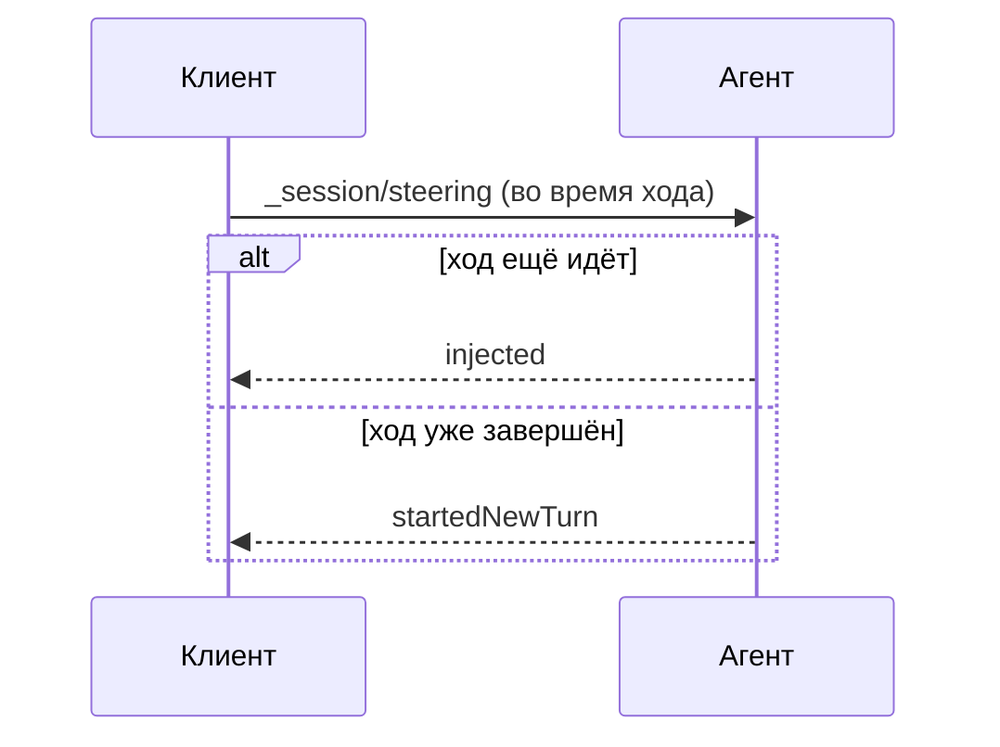

# Глава 18. Управление работающим агентом: steering и цели

[← Назад](17-acp.md) · [Оглавление](README.md) · [Далее →](19-junie-live.md)

Агент работает минуты, иногда часы. Пользователь видит, что он пошёл не туда, или вспомнил важное требование, или хочет сменить приоритет. Что делать? Варианты в обычном чате: подождать конца хода и написать снова, или остановить агента и начать заново. Оба плохи: первый медленный, второй выбрасывает уже сделанную работу.

В этой главе два механизма, которые решают эту задачу с разных сторон. **Steering** — отправить сообщение во время работы, не дожидаясь конца хода. **Goal** — сделать саму цель состоянием сессии: агент знает, чего он добивается, и клиент может это видеть и менять. Оба построены как расширения ACP (глава 17), и оба дали урок о том, что такое «ход» и что такое «задача».

## 18.1. Сообщение во время работы

Steering позволяет клиенту отправить follow-up, пока задача ещё выполняется. Протокол описывает два успешных исхода, и оба — не ошибки:

- **`injected`** — задача ещё шла, и сообщение добавлено в неё, так что агент учтёт его в работе.
- **`startedNewTurn`** — задача закончилась раньше, чем агент обработал запрос. Сообщение не потеряно: агент начал новый ход и выполнил его.

Формулировка контракта жёсткая: сообщение **никогда не теряется**, и запрос «слишком поздно» **никогда не возвращается как ошибка JSON-RPC**. Это важное решение. Если бы опоздание было ошибкой, клиенту пришлось бы самому решать, что делать, и каждый клиент решал бы по-разному. Поэтому гонка между концом хода и сообщением разрешается внутри агента.

Почему это трудно. Агент работает в цикле (глава 2), и сообщение может прийти в любой момент: во время вызова модели, во время правки файла, между шагами. Для каждого случая нужно решить: добавить в текущий ход или начать новый. Решение зависит от того, что уже произошло. Документ описывает это как «решения по фазе хода» (`Decision by turn phase`).

## 18.2. Команды во время работы

Самое тонкое место — слэш-команды. Пользователь может написать `/stats` или `/plan close` во время работы. Такие команды нельзя отправлять модели как обычный текст: модель получит строку `/stats` и ответит на неё как на вопрос.

Решение: команды делятся на три класса.

1. **Команды, которые работают в текущем ходе** (`SteerableAcpCommand`): статус, переключение режимов, `/mcp`, `/sandbox`, `/plan close`, `/goal close`. Они выполняются сразу и выдают обновления, не отправляя ничего модели.
2. **Команды, которые расширяют промпт** (`/<навык>`, `/<пользовательская>`). Они раскрываются и вставляются в работающую задачу как дополнительная инструкция.
3. **Команды, которые запускают новую задачу или меняют состояние глобально** (`/compress`, `/rollback`, `/new`, `/review`, `/goal <задача>`, `/plan <задача>`). Во время хода они отклоняются с кодом `steering_turn_busy`.

Третий класс — самый важный. Команда `/rollback` во время работы откатила бы файлы, которые агент сейчас меняет. `/new` оставила бы задачу висеть. Поэтому они запрещены, а отказ получает понятный код, а не молчаливое игнорирование.

Заметьте, как эта классификация выросла. Класс `SteerableAcpCommand` появился 2 ноября 2026 года («fix /remote command state and slash-command steering»), через несколько месяцев после самого steering. Судя по заголовку коммита, до этого поведение команд во время работы исправляли по одной. Каждая команда получила явное решение, в каком классе она живёт. Ссылки на этот класс в `ej-app` — около двадцати двух.

## 18.3. Почему «никогда не теряем» — это правило, а не удобство

Представим клиента, который отправляет сообщение, а агент уже закончил. Если сообщение теряется, пользователь пишет его снова, а потом понимает, что агент ничего не сделал. Если сообщение попадает в новый ход, пользователь видит реакцию. Первое — тихий провал, второе — работающая система.

Правило «никогда не терять» требует, чтобы у агента была очередь или хотя бы явный механизм «начать новый ход». Это простая идея, но её легко нарушить: достаточно одного пути в коде, где сообщение, пришедшее в неподходящий момент, просто отбрасывается. Поэтому в документе правило записано как контракт, а не как пожелание.

## 18.4. Цели: состояние, а не один запрос

Вторая половина главы — расширение **Goal**. Идея документа сформулирована в его заголовке: «a goal is session state, not one prompt». Цель живёт дольше одного запроса. Статус `active` означает, что цель может управлять дальнейшей работой. Это **не** означает, что сейчас выполняется промпт.

Для клиента это меняет модель взаимодействия. Раньше пользователь отправлял задачу и ждал. Теперь он задаёт цель, которую агент держит, и может её изменить, не отправляя новый промпт. Это ближе к тому, как работают люди: руководитель задаёт направление, а не каждый шаг.

Протокол описывает три поверхности:
- агент объявляет поддержку цели в `initialize`;
- клиент управляет целью через метод `_session/goal` с действиями `set` и `clear`;
- состояние цели доступно клиенту.

Junie объявляет `["set", "clear"]`, то есть умеет ставить и закрывать цель, но **не** умеет её ставить на паузу или возобновлять. Документ не скрывает это ограничение: в объявлении возможностей перечислено ровно то, что реализовано.

Ключ `goal` в объявлении возможностей **отсутствует**, если режим цели недоступен, а не присутствует с пустым значением `{}`. Разница важна: клиент, который видит пустой объект, может решить, что цель поддерживается, но без действий. Отсутствие ключа означает однозначно «нет».

## 18.5. Условия доступности: клиент и модель

Цель доступна в версии v2 только при двух условиях: клиент объявляет форму подтверждения (`elicitation.form`), а текущая модель поддерживает цели. Вторая проверка связана с моделями (глава 16): не каждая модель годится для долгой работы по цели. Политика одна и та же для обнаружения команды `/goal`, для конфигурационного значения `goal` и для проверки плана перед переводом в цель.

Заметьте: проверка повторяется после смены модели. Цель, доступная на одной модели, может исчезнуть на другой, и клиент должен это узнать, а не получить ошибку при попытке.

## 18.6. План и цель: два режима, которые легко спутать

Цели тесно связаны с режимом планирования. Команда `/plan` переводит сессию в режим, в котором агент сначала составляет план, а затем по нему работает. Документ описывает тонкие правила:

- повторная команда `/plan` не выключает режим;
- `/plan close` возвращает обычный режим и **останавливает работающую цель**, а не только планирование;
- файл плана остаётся на диске, даже когда планирование закрыто;
- `/plan <задача>` начинает с чистого состояния и создаёт новый файл, а не переиспользует закрытый.

Эти правила кажутся педантичными, но каждое закрывает конкретную ошибку. Если бы `/plan close` оставлял цель работать, пользователь думал бы, что агент остановлен, а он продолжал менять файлы. Если бы повторный `/plan` выключал режим, нажатие «случайно дважды» отменяло бы планирование молча.

Правило, которое стоит запомнить: **команда закрытия должна останавливать всё, что она обещает закрыть, и ничего больше**. Файл плана — данные пользователя, поэтому он сохраняется.

## 18.7. Что дал второй релиз

Хронология:
- **21 июля 2026** — сообщения во время работы, `steering` в ACP.
- **20 августа 2026** — документ о расширении целей, с ссылкой на аналогичные реализации в других агентах. Заметьте: контракт описан одинаково в двух репозиториях, и это попытка стандартизации, а не собственный протокол.
- **1 октября 2026** — в ACP V2 появляется код ошибки `steering_turn_busy` (коммит про терминал, команды и промпты).
- **2 ноября 2026** — команды во время работы получили класс `SteerableAcpCommand`.

Видно, что работа шла параллельно: контракт на цели описывали одновременно с тем, как его реализовывали, и в документе указаны ограничения реализации (отсутствие паузы).

## 18.8. Что из этого следует

1. **Гонку между концом хода и новым сообщением разрешайте внутри агента.** Клиент не должен получать «слишком поздно» как ошибку.
2. **Сообщение не теряйте.** Если нельзя добавить в текущий ход, начинайте новый.
3. **Классифицируйте команды по тому, что они делают во время работы.** Одни выполняются сразу, другие расширяют задачу, третьи запрещены.
4. **Цель — состояние сессии**, а не один запрос. Статус «активна» не означает «сейчас выполняется».
5. **Объявляйте только реализованное.** Список действий должен совпадать с возможностями.
6. **Отсутствие возможности и пустая возможность — разные вещи.** Не используйте `{}` вместо отсутствия ключа.
7. **Команда закрытия останавливает то, что обещает, и ничего больше.**

## Упражнение

1. Реализуйте агента, который принимает сообщения во время работы. Если ход активен, добавьте сообщение в текущий ход. Если нет, начните новый. Проверьте, что ни одно сообщение не пропадает при трёх гонках: до начала, во время и сразу после окончания хода.
2. Разделите команды на три класса: выполняется сразу, расширяет задачу, запрещена во время работы. Для запрещённых верните код ошибки, а не игнорируйте команду. Проверьте, что `/rollback` во время работы отклоняется.
3. Реализуйте цель как состояние сессии: команда `set` задаёт цель, `clear` её закрывает, и статус `active` сохраняется между промптами. Проверьте, что новый промпт не сбрасывает цель.
4. Объявите возможности так, чтобы отсутствующая возможность не появлялась в ответе вообще. Проверьте, что клиент без поддержки формы не получает ключа цели.

## Источники

Все коммиты из главы находятся в истории `junie-repo` (ветка `main`); в тексте приведены их заголовки и даты. Контракты — `docs/acp-steering.md` и `docs/acp-goal-extension.md`. Классы `Steering.kt` и `SteerableAcpCommand` проверены по HEAD. Число ссылок на класс (около двадцати двух) получено через `git grep` в `ej-app`.
